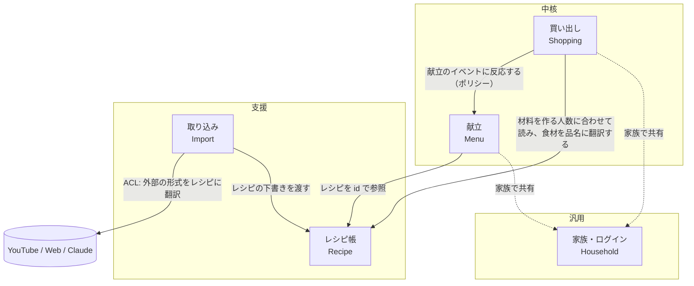

# コンテキストマップ

同じ言葉でも意味が変わる境目で領域を分ける。例えば同じ「豚ばら肉 200g」でも、レシピ帳では「材料」（レシピに書かれた分量と下ごしらえ）、買い出しでは「買う物」（作る人数で増減し、使う日と出どころを持つ）になる。

| コンテキスト | 種類 | 責務 | 現在のコード |
|---|---|---|---|
| 献立 | 中核 | 食事ごとに何を食べるかを決める。作る人数・外食・残り物 | `src/domain/menu/`、`meals`・`dishes`・`leftovers` テーブル、`meal-calendar.tsx`・`meal-sheet.tsx` |
| 買い出し | 中核 | 家族で共有する買い物リスト。食材も日用品も書く。献立との連動・書き足し・直し・区切りと並べ替え・チェック | `src/domain/shopping/`、`shopping_items` テーブル、`shopping-list.tsx` |
| レシピ帳 | 支援 | レシピの保存・編集・検索・削除 | `src/domain/recipe/`、`recipes` テーブル、`recipe-form.tsx` など |
| 取り込み | 支援 | 外部の情報をレシピの下書きに変換する（腐敗防止層）。基準人数と「食材・下ごしらえ」を分けて読み取る | `src/lib/import/` |
| 家族・ログイン | 汎用 | 誰が使えるか | Supabase Auth、`members` テーブル |

## 中核に選んだ理由

レシピの保存や取り込みは、ほかのレシピアプリにもある。この家族ならではの価値は「冷蔵庫の中身に合わせて献立と買う物を柔軟に足し引きし、2 人で分担して買い出しすること」にある。

献立から買い出しへの連動は、献立のドメインイベント（`DishAdded`・`DishRemoved`・`DishServingsChanged`）をアプリケーション層が受け取り、`src/domain/shopping/menu-policy.ts` のポリシーで買い物リストに反映する。
