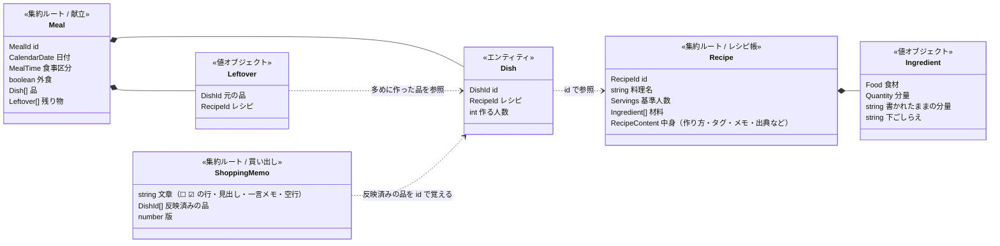

# ドメインモデル

集約（データの整合性を守る単位）と、必ず守られるべきルール（不変条件）をまとめる。
用語は [glossary.md](glossary.md) に従う。各ルールは `src/domain/**/*.test.ts` と `src/application/use-cases.test.ts` でテストしている。

## 全体像

## レシピ帳コンテキスト

### 集約: レシピ（Recipe）

レシピの保存は、必ずこの集約を通す（編集画面 → `saveRecipeAction` → ユースケース `saveRecipe`）。作り方・タグ・メモ・出典などの中身（`RecipeContent`）も集約が持ち、保存の前に整える（空の手順や重複したタグを除く）。

| ルール | 内容 |
|---|---|
| R1 | 料理名は必須 |
| R2 | 材料の食材名は空にできない |
| R3 | 基準人数は取り込み時に「〇人分」「〇人前」の記載を探して設定する（幅があれば少ない方）。見つからなければ 2 人分とみなし、画面で「記載なし」と分かるようにする |
| R6 | 作る人数に合わせて材料を増減するときは「作る人数 ÷ 基準人数」倍する（1 人前のレシピを 2 人分作るなら 2 倍） |
| R7 | 出典の URL は http:// か https:// で始まる（画面でリンクにするため）。保存済みのデータに合わない URL があっても、読み込みは失敗させず出典なしとして読む |
| R8 | 材料の分量は書かれたままの表記で保存する（数値に読み替えた分量は、増減と合算にだけ使う） |
| R9 | 写真から取り込んだときは、選んだ画像を元の画像として選んだ順に残す（http(s) の URL だけ）。一覧や詳細の写真には、完成した料理が写っている画像を使い、なければ 1 枚目を使う |
| R4 | レシピを削除すると、そのレシピを使った品は献立から消える |
| R5 | 当日以降の献立で使われているレシピを削除するときは、削除前に確認する |

### 値オブジェクト: 食材（Food）

- 店で買う物としての名前。**部位や種類は食材の一部**（豚ばら肉 ≠ 豚ロース肉）
- 下ごしらえ（みじん切り・薄切りなど）は食材に含めず、材料の別の項目として持つ
- 全角・半角や空白の違いは同じ食材とみなす
- 部位が書かれていない食材（豚肉）と部位が書かれた食材（豚ばら肉）は別の食材とみなす（どちらを買うか迷わないように）

### 値オブジェクト: 分量（Quantity）

- 「大さじ2」「200g」「1/2個」のように数えられる分量は、**人数に合わせて増減できる**
- 「少々」「適量」のように数えられない分量は、増減せずそのまま
- 同じ単位どうしは合算できる（大さじ2 ＋ 大さじ1 ＝ 大さじ3）。単位が違えば合算しない
- 表示はレシピでよく使う書き方に寄せる（1.5 → 1と1/2、0.5 → 1/2、g・ml は 10 以上なら整数）

## 献立コンテキスト

### 集約: 食事（Meal）

ある日の朝・昼・夜の 1 回分。献立はこの食事に並ぶ品の組み合わせ。
M7 と M10 は複数の食事にまたがるので、食事のクラスではなくドメインサービス（`src/domain/menu/menu-service.ts`）で守る。

| ルール | 内容 |
|---|---|
| M1 | 日付と食事区分の組み合わせごとに、食事は 1 つ |
| M2 | 品は必ずレシピを参照する（バナナのようにレシピのない物は献立に入れない。必要なら買い物メモに直接書く） |
| M3 | 作る人数は 1 人以上。初期値は 2 人。カレーなど翌日も食べるときは増やす |
| M4 | 外食の食事には品を入れられない |
| M5 | 主菜・副菜・汁物の区別は持たない |
| M6 | 残り物は、それより前の食事で多めに作った（作る人数が 2 人より多い）品を参照する |
| M7 | 元の品が献立から外れたら、その残り物も外れる |
| M8 | 残り物は買い物を発生させない（献立の材料を反映しても、残り物の材料は入らない） |
| M9 | 残り物は、献立に品を追加するときに「残り物」を選び、多めに作った品の中から選んで入れる |
| M10 | 残り物として献立に入っている品は、作る人数を 2 人分以下に減らせない（先に残り物を外す） |
| M11 | 外食をやめると、その食事は空に戻る（外していた品は戻らない）。品も残り物もなく外食でもない食事は保存しない |
| M12 | 残り物にできるのは、その食事の 1 週間前までに作った品（作り置きなどで 1 週間は食べることがある） |

## 買い出しコンテキスト

### 集約: 買い物メモ（ShoppingMemo）

家族で 1 枚だけ。ずっと使い続ける。食材も日用品も文房具も、メモ帳と同じように自由な文章で書く。
アプリは文章の中身を品名や分量に分けない。分かるのは「☐ ☑ で始まる行はチェックできる」ことだけ。

| ルール | 内容 |
|---|---|
| S1 | 家族で 1 枚。チェックした状態も含めて 2 人で共有する |
| S2 | メモは自由な文章。☐ で始まる行はチェックできる行（買う物）、☑ はチェック済み。それ以外の行は見出しや一言メモ、空行は買い物先などの区切りとしてそのまま残す |
| S3 | 「書く」と「買い物中」の 2 つの使い方がある。書くときはメモ帳と同じく自由に直せる（☐ の行で改行すると次の行にも ☐ が付き、空の ☐ の行で改行すると ☐ が外れる）。買い物中は行をタップして ☐ ↔ ☑ を切り替える |
| S4 | 買った行（☑）は、家族が「☑ を消す」を押したときだけまとめて消す（自動では消さない） |
| S5 | 献立の材料は、家族が期間（今日・明日・3 日分・1 週間）を選んで「反映」したときだけメモに入る |
| S6 | 反映するのは、その期間の献立のうちまだ反映していない品だけ。同じ品を二重に入れない。反映できる品がなければ、そう伝える |
| S7 | 反映するときは、作る人数に合わせて材料を増減し、同じ食材は 1 行にまとめて分量を合算する（単位が違えば「＋」でつなぐ）。「【10/26(月)〜10/28(水)の献立の材料】」の見出しを付けて、メモの末尾に ☐ の行で足す |
| S8 | 反映した後で献立を変えても（品を外す・人数を変える・外食にする）、メモは変わらない。足し引きはメモの上で行う。献立やレシピも変えない |
| S9 | 2 人がほぼ同時に書き換えても、相手の書いた行を消さない。保存するときに相手が先に保存していたら、行単位でまとめてから保存し直す（足した行はどちらも残り、消した行とチェックの切り替えは当てはめる） |
| S10 | 改行は \n のほか、iPhone のメモ帳などから届く \r や行区切り U+2028 も認める |

`src/domain/shopping/shopping-memo.ts` が、行の読み方（S2）、チェックの切り替え、☑ の行の削除（S4）、反映（S5〜S7）、行単位のまとめ（S9）を持つ。

## コンテキスト間のつながり

以前は、献立で起きたこと（品が加わった・外れた・人数が変わった）に反応して買い物リストを自動で増減するポリシーがあった。
メモ帳にしてからは、献立から買い出しへは**家族が「反映」を押したときだけ**つながる（S5・S8）。献立を変えても買い物メモは何も反応しない。
反映のユースケース（`reflectMenuIngredients`）が、期間内の品とレシピを献立から読み、買い物メモの集約に渡す。

## 保存のしかた

| 集約 | テーブル | 保存のしかた |
|---|---|---|
| レシピ | `recipes`（材料は `ingredients` jsonb、基準人数は `servings` integer。null = 記載なし。元の画像は `source_images`） | `saveRecipe` ユースケースで、レシピの集約を通して保存。画像そのものは Supabase Storage の `recipe-images` に置く（[D5](decisions.md)） |
| 食事 | `meals`（日付×食事区分で一意）・`dishes`・`leftovers` | 献立の変更を `save_meals_and_shopping` で 1 つのトランザクションとして保存（レシピ削除で外れる品も同じトランザクション） |
| 買い物メモ | `shopping_memo`（家族で 1 枚なので 1 行だけ。文章・反映済みの品・版） | `save_shopping_memo` で、保存されている版が手元の版と同じときだけ保存する。違えば行単位でまとめて保存し直す（[D6](decisions.md)）。2 人の画面には Supabase Realtime で反映 |

古い形式のデータ（下ごしらえが食材名に混ざった材料、文字列の基準人数）は、`src/infrastructure/recipe-mapper.ts` が読むときに新しい形に直す。

## DDD を始める前からの変更点（記録）

| 項目 | 以前 | 今 |
|---|---|---|
| 献立のまとまり | `meal_plans` の 1 行 = 1 品。食事としてのまとまりがない | `meals`（食事）・`dishes`（品）・`leftovers`（残り物）に分けた |
| 作る人数 | なし（常にレシピの分量そのまま） | 品ごとに作る人数を持ち、分量を増減する |
| 外食 | 表せない | 食事に「外食」を持たせる |
| 残り物 | 表せない | 食事に残り物を並べられる（買い物は増えない） |
| 食材の名寄せ | 括弧書きを捨てて合算するため、豚ばら肉と豚ロース肉が混ざる | 材料を「食材（name）・分量（amount）・下ごしらえ（preparation）」で保存し、食材が同じものだけ合算する。古いデータは読むときに分ける |
| 基準人数 | 文字列のまま。人数の計算に使えない | 数値で持ち（`recipes.servings integer`）、記載がなければ null = 2 人分とみなす |
| 買い物リスト | 保存されず、期間を選んで毎回計算。チェックは端末ごと | 家族で 1 枚の買い物メモを保存・共有。自由な文章で書き、献立の材料は「反映」で足す（一度は献立に合わせて自動で増減するリストにしたが、もっと自由に書きたいという声でメモ帳にした） |
| 手で足す物 | できない | できる（メモに自由に書く） |
| レシピ削除 | 確認なしで献立からも消える | 当日以降の献立で使われていれば確認する |
